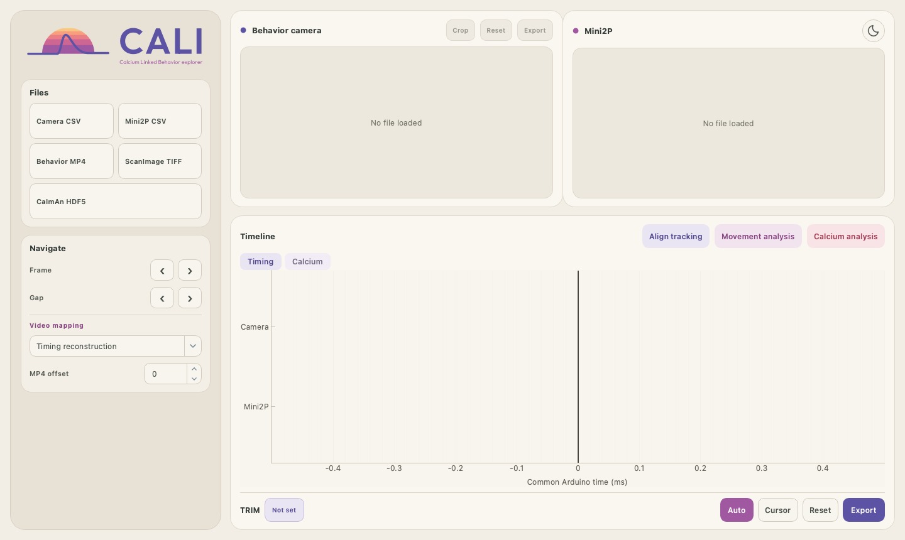
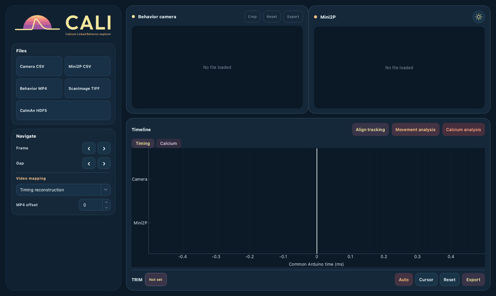

<p align="center">
  <picture>
    <source media="(prefers-color-scheme: dark)" srcset="cali/assets/icons/logo/cali_logo_horizontal_dark.svg">
    
  </picture>
</p>


**CA**lcium **LI**nked Behavior explorer is a local Python desktop application for
inspecting Mini2P imaging and behavior video on a shared TTL timeline. It can
align existing tracking data, run CaImAn motion correction and CNMF, and explore
associations between calcium activity and movement.

Its current acquisition focus is Mini2P; it does not generate behavioral tracking.



<details>
<summary>Night mode</summary>



</details>

## Install and launch

Use **Python 3.11**. Local validation is on macOS Apple Silicon; other platforms
have not yet been validated. The viewer and its tests do not require CaImAn.

Install [uv](https://docs.astral.sh/uv/getting-started/installation/), then
clone the repository into a folder named `CALI` and install the `cali` command.
uv downloads Python 3.11 if it is not already installed.

```bash
git clone https://github.com/Lorena-J/CALI.git CALI
cd CALI
uv tool install --python 3.11 --editable . -c requirements-lock.txt
```

Then open the application from any terminal, in any folder:

```bash
cali
```

If the terminal answers `command not found`, run `uv tool update-shell` once
and open a new terminal.

- **Updating:** `git pull` inside `CALI` is enough, because the command runs
  the code from this folder. Keep the folder where it is. If the dependencies
  change, re-run the install command above with `--reinstall`.
- **Uninstalling:** `uv tool uninstall cali`.

`requirements.txt` and `pyproject.toml` pin the viewer's direct dependencies.
`requirements-lock.txt` (and `uv.lock`) also pin their runtime dependencies for
the tested Python 3.11 stack. These files do not lock system libraries or
guarantee identical builds across platforms.

To **process** TIFFs, install the separate optional CaImAn engine. CaImAn is
distributed through conda-forge, so this step uses Conda (for example
[Miniforge](https://github.com/conda-forge/miniforge)):

```bash
conda env create -f envs/environment-caiman.yml
```

Do not install it with `pip install caiman` or `uv pip install caiman`: the
`caiman` package on PyPI is an unrelated project. The viewer does not need to
run inside the Conda environment; it finds the `cali-caiman` environment
automatically. Reading saved CaImAn HDF5 results needs only the viewer. See
[processing setup and workflow](docs/calcium-processing.md) for custom engine
locations and compatibility constraints.

## What to load

Use the **Files** buttons to select local files:

| Input | Purpose | Required format |
| --- | --- | --- |
| Camera CSV | Behavior-camera timing | CSV with `frame` and `timestamp_ms` |
| Mini2P CSV | Imaging timing | CSV with `frame` and `timestamp_ms` |
| Behavior MP4 | Behavior images | Video corresponding to the camera TTLs |
| ScanImage TIFF | Imaging images and/or CaImAn processing | TIFF; processing currently supports one plane |
| CaImAn HDF5 | Existing calcium traces and footprints | `.h5`/`.hdf5` from `cnm.save(...)`; completed CALI runs can also open through their manifest |
| Tracking CSV | Align tracking or analyze movement | Flat CSV or DeepLabCut multi-header CSV, referenced to the original behavior video |

The full synchronized image view uses both TTL CSVs, behavior video and its
corresponding imaging TIFF. **Calcium analysis** can process TIFFs without TTLs,
video or tracking. Reading calcium results can also work without TTLs, using
movie-frame coordinates.

## First synchronized view

1. Load **Camera CSV**, **Mini2P CSV**, **Behavior MP4** and **ScanImage TIFF**.
   Both TTL files must use the same acquisition clock in milliseconds.
2. Inspect the **Timing** tab. Click the timeline or move its cursor to browse
   the nearest camera and imaging frames. Left/right arrows step imaging frames;
   PageUp/PageDown move between detected camera gaps.
3. Check **Video mapping** and **MP4 offset** against your acquisition. Offset
   is in video frames, not milliseconds; it defaults to zero. Missing camera TTLs
   are reconstructed on load, so verify the mapping against real video frames.
4. Use **Align tracking** to align one numeric tracking coordinate to camera or
   Mini2P times. Use **Calcium analysis** to process TIFFs, or load existing results
   through **CaImAn HDF5**. **Movement analysis** requires both TTLs, calcium results
   and tracking from the original behavior video.
5. Use the theme button in the Mini2P header to switch between day and night mode.

Raw TIFF browsing currently maps Mini2P frame ID 1 to TIFF page 0. Do not assume
that this matches an interleaved multichannel or multiplane acquisition. Channel
selection and source-page provenance belong to the processing workflow.

For CSV examples, index conventions, reconstruction limits and export behavior,
see [synchronization and tracking](docs/synchronization.md).

## Guides

- [Synchronization, tracking, crops and trims](docs/synchronization.md)
- [Motion correction and CNMF processing](docs/calcium-processing.md)
- [Inspecting and exporting calcium results](docs/calcium-results.md)
- [Movement and calcium activity](docs/movement-analysis.md)
- [Validation record and remaining coverage](docs/processing-validation.md)
- [Development and automated checks](docs/development.md)

## Validation and limitations

The automated suite uses synthetic fixtures for timing, tracking, HDF5 results,
processing orchestration and exports. Real CaImAn processing has been tested on
its official example movie. Demo behavior, TTLs and tracking are simulated and
have no biological association with that movie.

Synchronization with real acquisition clocks and processing an authentic
multichannel ScanImage acquisition remain to be validated. Multiplane/flyback
processing is unsupported. Automatic component acceptance is not confirmation
of a neuronal identity; deconvolved `S` is not a measured spike train. Movement
statistics are descriptive and exploratory.

CALI keeps session state in memory; session save/restore is not implemented.
Original inputs are preserved. Processing can require several float32 copies
of a movie, and failed or cancelled runs retain partial outputs.

## Tests

From the repository root (`uv run` creates `.venv/` from `uv.lock` the first
time):

```bash
QT_QPA_PLATFORM=offscreen uv run python -m unittest discover -s tests -v
```

The proposed GitHub Actions workflow runs these checks on macOS with Python
3.11 after pushes and pull requests. Its presence does not mean a remote run has
already passed; see the repository's Actions tab after publication.

## License

This project is licensed under the MIT License © 2026 Lorena Jiménez and
Anna Teruel-Sanchis. See the [LICENSE](LICENSE) file for details.

Dependencies and external example data have their own terms; no experimental
recordings or example movies are bundled in this repository.
